# CT36 EFSA: length of the food-reduction window (acute scenario)

This test is not part of the report. It explains the window lengths used in the report.

In the acute scenario (report section 3.3), the reduced f lasts an n-day window that starts
at the onset of a stage. The window is 7 days for the birds, the shrews and *Podarcis*. For the two
amphibians it was lengthened to 18 weeks (126 d, *Rana*) and 48 weeks (336 d, *Ichthyosaura*),
because a 7-day window has almost no visible effect on these slow-growing species. This page
shows what 7 days gives for the amphibians. It also shows *Podarcis* with longer windows (4, 8 and
16 weeks), since its 7-day figure has the same problem.

The code is the same as in the report, except the window length `d` in the predict file.
To reproduce: `bash zoo_collection/CT36EFSA_window_length/run_window_length_CT36EFSA.sh`
(about 6 min). It works on temporary copies of the species folders, so the repository files are
not modified, and it writes the figures in `CT36EFSA_window_length/`.

## Summary

Female SVL (snout-vent length), compared with the factor-1 curve at the same time.

- **Max. dip**: the most negative % change over time.
- **End**: the % change at the last time point (5000 d for *Rana*, 8000 d for *Ichthyosaura*,
  6000 d for *Podarcis*).

| Species | Window | Stage | Max. dip, factor 0.5 | Max. dip, factor 0.8 | End, factor 0.5 |
|---|---|---|---:|---:|---:|
| *Rana temporaria* | **126 d (report)** | nest | −11.2 % | −3.4 % | 0.00 % |
| | | juvenile | −24.0 % | −7.5 % | 0.00 % |
| | | adult | −18.3 % | −6.4 % | 0.00 % |
| | 7 d | nest | −2.1 % | −0.7 % | 0.00 % |
| | | juvenile | −1.3 % | −0.5 % | 0.00 % |
| | | adult | −0.9 % | −0.3 % | 0.00 % |
| *Ichthyosaura alpestris* | **336 d (report)** | nest | −32.0 % | −12.0 % | −0.04 % |
| | | juvenile | −20.9 % | −7.9 % | −0.06 % |
| | | adult | −12.2 % | −4.6 % | −0.17 % |
| | 7 d | nest | −1.5 % | −0.6 % | 0.00 % |
| | | juvenile | −0.6 % | −0.2 % | 0.00 % |
| | | adult | −0.3 % | −0.1 % | 0.00 % |
| *Podarcis muralis* | **7 d (report)** | juvenile | −0.9 % | −0.4 % | 0.00 % |
| | | adult | −0.5 % | −0.2 % | 0.00 % |
| | 4 weeks (28 d) | juvenile | −3.7 % | −1.4 % | 0.00 % |
| | | adult | −2.1 % | −0.8 % | 0.00 % |
| | 8 weeks (56 d) | juvenile | −7.3 % | −2.8 % | 0.00 % |
| | | adult | −4.3 % | −1.7 % | 0.00 % |
| | 16 weeks (112 d) | juvenile | −13.6 % | −5.2 % | 0.00 % |
| | | adult | −8.5 % | −3.2 % | −0.01 % |

- **7 days is too short for the amphibians:** at most −2 % at factor 0.5, against −11 to
  −32 % with the windows of the report.
- ***Podarcis* behaves the same way at 7 days:** under 1 %. A dip of 10–25 %, as for the
  amphibians in the report, needs a window of about 8–16 weeks.
- **The window sets only how deep and how long the dip is.** In all cases, the animals
  recover their final size by the end of the plotted period.

## *Rana temporaria*

### 126 days (report, Fig 3.10)
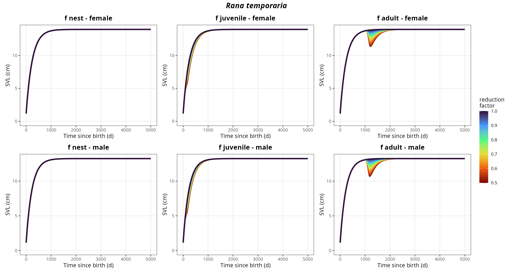
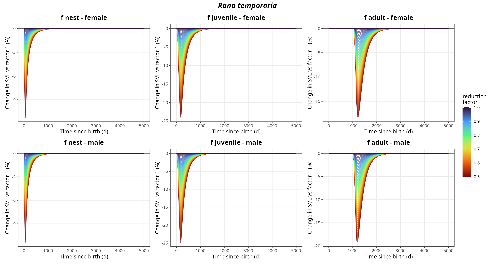

### 7 days
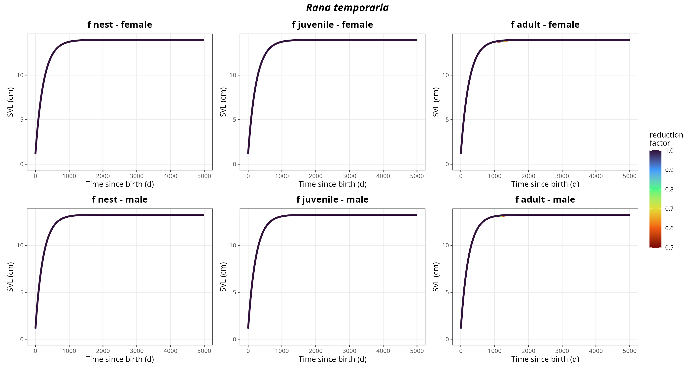
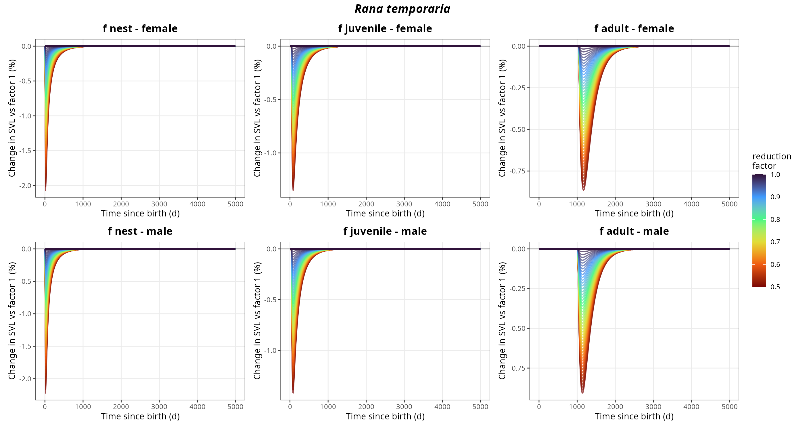

## *Ichthyosaura alpestris*

### 336 days (report, Fig 3.9)
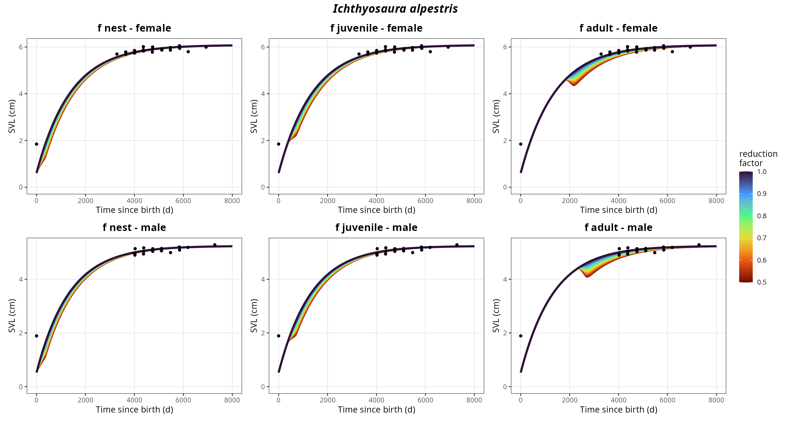
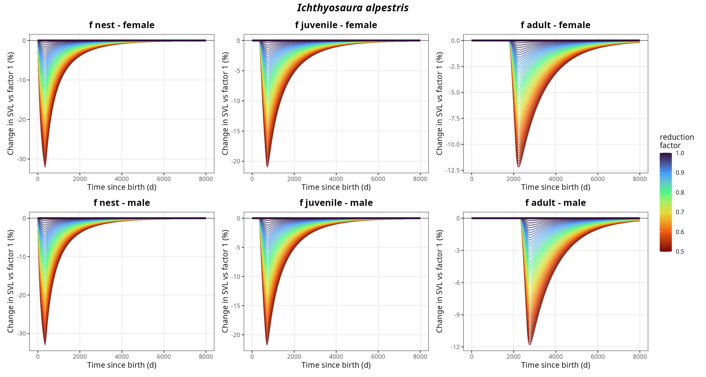

### 7 days
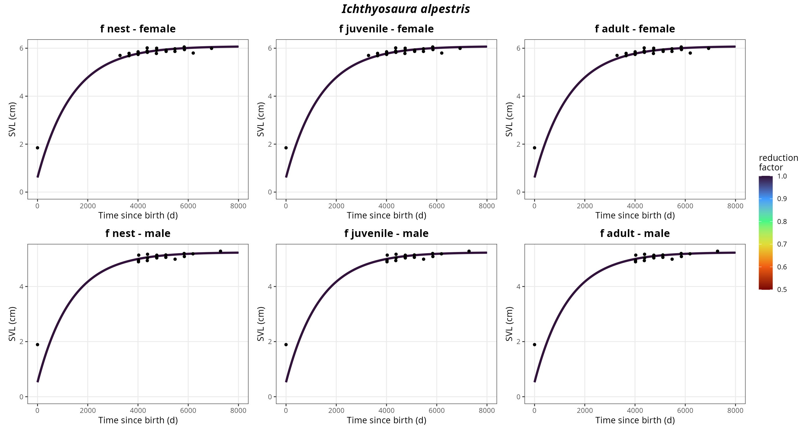
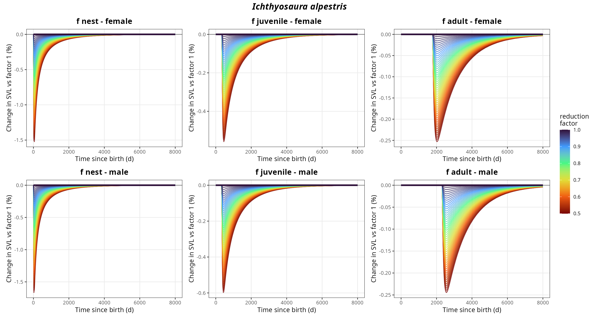

## *Podarcis muralis*

### 7 days (report, Fig 3.11)

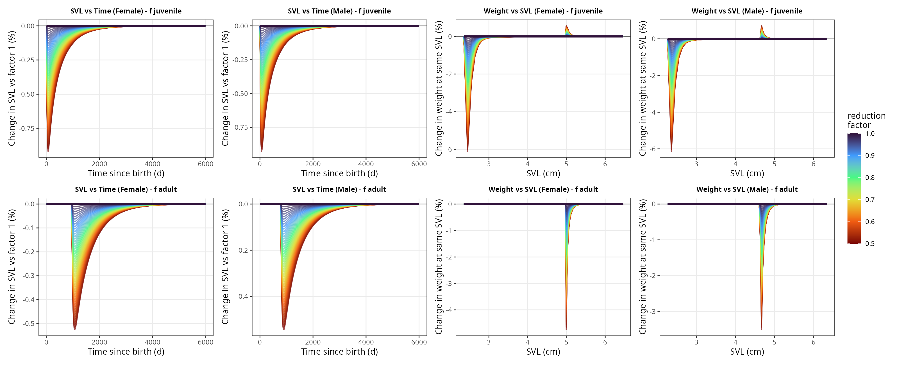

### 4 weeks

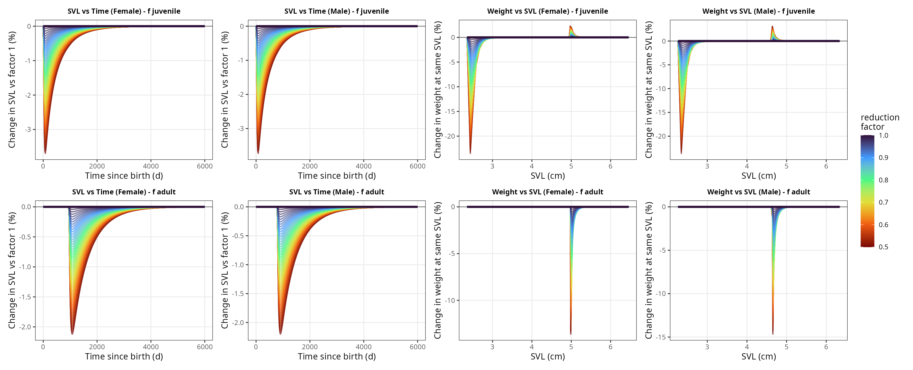

### 8 weeks
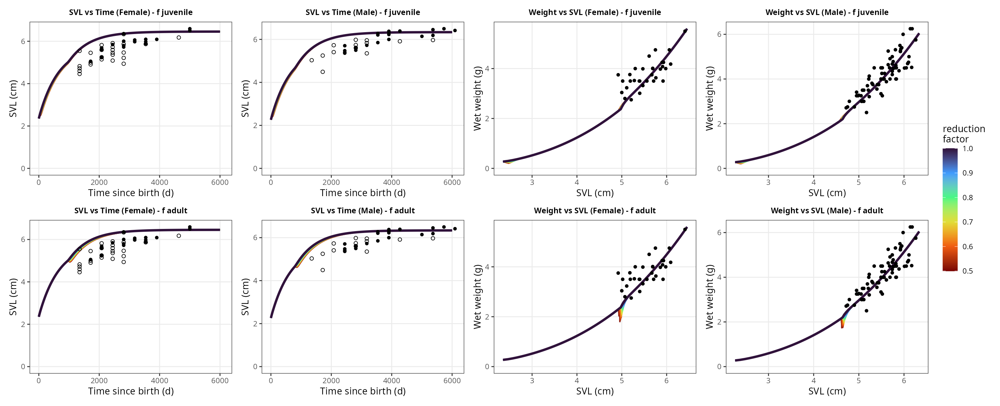
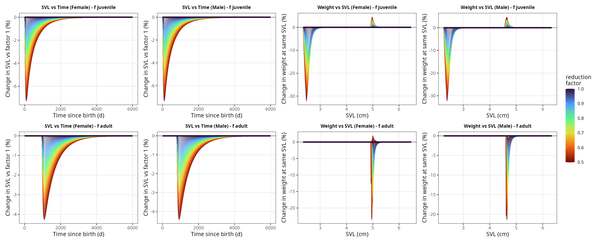

### 16 weeks
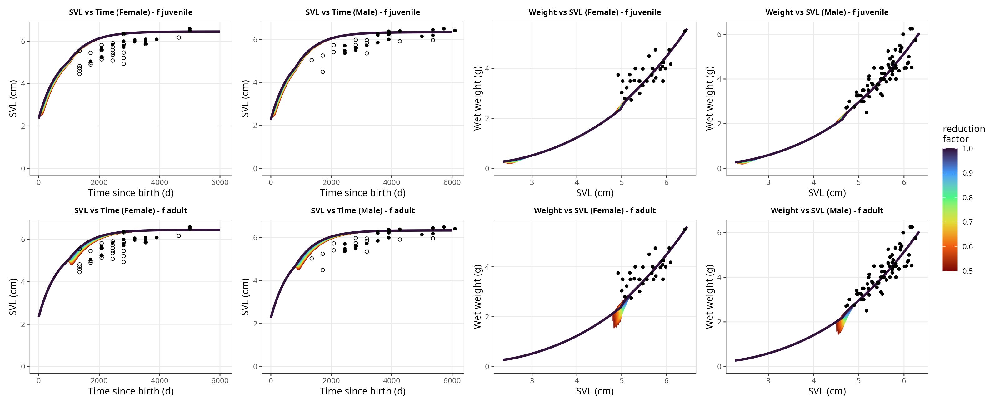
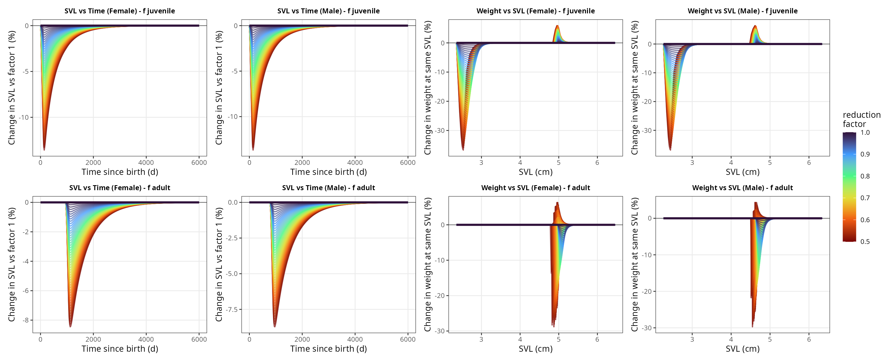
